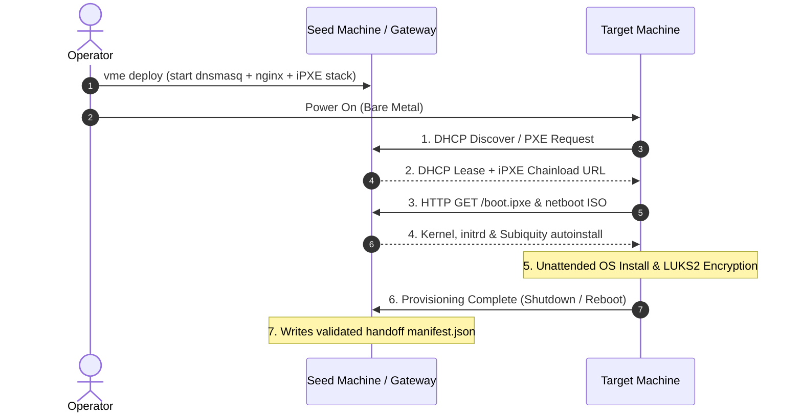

# VME — metal provisioning engine

<!-- ENGINE-STATUS:BEGIN region=engine-pill-vme -->
**Phase 1 · Alpha**
<!-- ENGINE-STATUS:END region=engine-pill-vme -->

Bare-metal provisioning. PXE boot any x86_64 hardware, install Proxmox VE
or Ubuntu Server fully unattended, write a handoff manifest, tear down
the seed stack.

VME is the foundation everything else builds on. It is also independently
useful — many users only ever need VME.

## Pages

- [Getting started](getting-started.md) — full walkthrough.
- [Compatibility](compatibility.md) — supported hardware and OS combinations.

## Architecture in one diagram

The seed stack is fully containerised (Docker Compose). Re-running VME
against an already-provisioned machine is safe — VME is stateless.

## Source

- Repository: [velocit-ee/core](https://github.com/velocit-ee/core), `vme/`
- License: Apache 2.0
